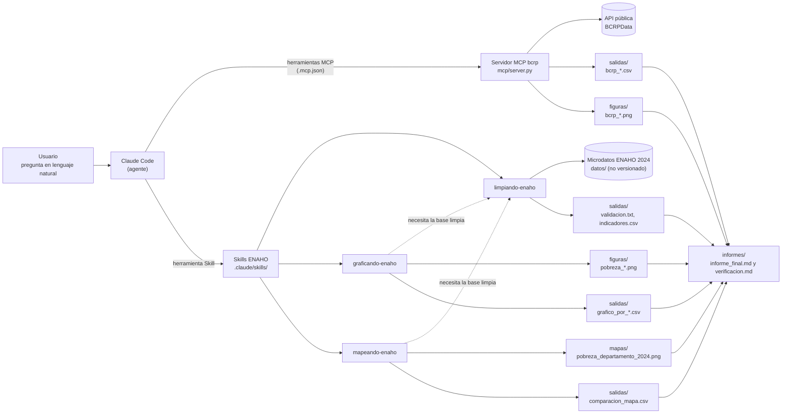

# Tarea 4 – Agente de investigación socioeconómica del Perú

Referencia oficial: <https://github.com/d2cml-ai/Data-Science-Python/issues/201>

> **Sobre las cifras de este README.** Ninguna se escribe a mano. Los bloques marcados como «Generado por
> `scripts/actualizar_readme.py`» se leen de `salidas/` y `evaluacion/`; el resto del texto remite a esos
> archivos. Para regenerarlos: `uv run python scripts/actualizar_readme.py`.

## Contenido

1. [Objetivo](#1-objetivo)
2. [Arquitectura del agente](#2-arquitectura-del-agente)
3. [Herramientas MCP](#3-herramientas-mcp-mcpserverpy)
4. [Las tres Skills](#4-las-tres-skills-claudeskills)
5. [Fuentes y descarga de datos](#5-fuentes-y-descarga-de-datos)
6. [Instalación con uv](#6-instalación-con-uv)
7. [Conectar el MCP a Claude Code](#7-conectar-el-mcp-a-claude-code)
8. [Reproducir el procesamiento y las pruebas](#8-reproducir-el-procesamiento-y-las-pruebas)
9. [Resultados de la evaluación](#9-resultados-de-la-evaluación)
10. [Limitaciones y problemas encontrados](#10-limitaciones-y-problemas-encontrados)
11. [Ejemplo de ejecución completa](#11-ejemplo-de-ejecución-completa)
12. [Evidencias de uso de IA](#12-evidencias-de-uso-de-ia-evidencias_ia)

## 1. Objetivo

Construir un agente en Claude Code que responda preguntas socioeconómicas del Perú con **datos oficiales y
verificables**, sin responder de memoria. Combina dos fuentes:

- **BCRP** (series macroeconómicas), a través de un servidor MCP propio.
- **ENAHO 2024 del INEI** (microdatos de hogares), a través de tres Skills que limpian, grafican y mapean.

Pregunta de investigación del informe final (`informes/informe_final.md`):

> ¿Cómo evolucionaron la inflación, el tipo de cambio y la actividad económica del Perú entre 2020 y 2024,
> y qué diferencias por área y departamento presentaba la pobreza monetaria en 2024?

| Parte | Qué hace | Dónde |
|---|---|---|
| 1. Servidor MCP del BCRP | Busca, descarga, resume, correlaciona y grafica series del BCRP | `mcp/` |
| 2. Skills de la ENAHO | Limpieza y validación, gráficos con IC 95 % y mapa por departamento | `.claude/skills/` |
| 3. Integración | El agente usa MCP y Skills juntos y escribe el informe con su verificación | `informes/`, `figuras/`, `mapas/`, `salidas/` |
| 4. Evaluación | 10 preguntas en dos modos (sin y con MCP/Skills) y análisis complementario B2 | `evaluacion/` |

## 2. Arquitectura del agente



- **Claude Code** decide qué herramienta usar. No calcula cifras: las pide al MCP o a los scripts de las
  Skills, y cita el código de la serie o el archivo de `salidas/`.
- **MCP `bcrp`** (Python, `fastmcp`) habla con la API del BCRP y hace las cuentas con pandas.
- **Skills**: cada una es un `SKILL.md` con instrucciones y un script fijo, así el resultado es el mismo
  en cada ejecución. Las Skills de gráfico y mapa activan primero `limpiando-enaho` si falta la base.

## 3. Herramientas MCP (`mcp/server.py`)

Usa la API pública del BCRP (<https://estadisticas.bcrp.gob.pe/estadisticas/series/api>), que no pide clave.
El catálogo de series se descarga la primera vez a `mcp/datos/`, que no se sube al repositorio.

| Herramienta | Qué hace |
|---|---|
| `buscar_series(texto, frecuencia, limite)` | Busca códigos de serie por palabras (p. ej. "ipc 12 meses"). |
| `serie(codigo, desde, hasta)` | Datos de la serie con periodos normalizados, valores `n.d.` omitidos y `fuente` = URL consultada. |
| `resumen(codigo, desde, hasta)` | Primero, último, cambio, variación %, promedio, máximo y mínimo con su periodo (pandas). |
| `correlacion(codigo_a, codigo_b, desde, hasta)` | **Herramienta propia.** Correlación de Pearson entre dos series de la misma frecuencia: alinea periodos, descarta faltantes, exige ≥ 3 periodos y devuelve coeficiente, n, periodos, descartados, fuentes y una nota de que es una asociación descriptiva, no causal. |
| `graficar_serie(codigo, desde, hasta, titulo)` | Descarga la serie con la misma lógica que `serie` y guarda `salidas/bcrp_<codigo>.csv` y un gráfico de línea en `figuras/bcrp_<codigo>.png`. Devuelve las rutas, el código, el periodo efectivo, n y la fuente. |

Además:

- **Recurso** `bcrp://serie/{codigo}`: ficha de la serie (nombre, categoría, frecuencia, inicio, última
  actualización y enlace de la API).
- **Prompt** `informe(tema)`: pide un informe en el que cada cifra cite **código, periodo y fuente**, use solo
  las herramientas y no presente asociaciones como causales.

### `graficar_serie`: gráfico para el informe

Usa el mismo estilo que las figuras de la ENAHO: línea azul oscuro (`#1F4E79`), título analítico, subtítulo
con el nombre de la serie, la **unidad**, la frecuencia y el **periodo**, y la nota
`Fuente: BCRP, serie <codigo>, <url>`. El `titulo` debe salir de `resumen`, no de memoria; si se deja vacío,
se arma con el primer y el último valor descargados. La unidad sale del catálogo o, si falta, del último
paréntesis del nombre de la serie. Si hubo periodos `n.d.`, la nota dice cuántos se omitieron.

### Parseo de fechas

La API usa un formato para lo que se le **pide** y otro para lo que **devuelve**:

- `_periodo_api(periodo, frecuencia, fin)` traduce lo que escribe el usuario (`2025`, `2025-03`,
  `2025-03-15`, `2025-T1`) al formato de la API según la frecuencia: diaria `2025-03-15`, mensual `2025-3`,
  trimestral `2025-1`, anual `2025`.
- `_normalizar_periodo(nombre)` traduce la respuesta a un formato ordenable:

| La API devuelve | Normalizado |
|---|---|
| `Ene.2025` | `2025-01` |
| `Set.2025` / `Sep.2025` | `2025-09` |
| `01.Oct.26` | `2026-10-01` |
| `T1.25` | `2025-T1` |
| `2025` | `2025` |

Los meses se leen de un diccionario propio en español (incluye `Set` y `Sep`), así el resultado no depende
del idioma de la computadora. Los años de dos dígitos siguen el corte de Python: `00–68` → 20xx y
`69–99` → 19xx.

## 4. Las tres Skills (`.claude/skills/`)

Metodología: [Sesión 16 del curso](https://github.com/d2cml-ai/Data-Science-Python/tree/main/sessions/16-skills-enaho).
Se versionan con el repositorio. Cada una corre un script fijo.

| Skill | Qué hace | Entra | Sale |
|---|---|---|---|
| `limpiando-enaho` | Lee los módulos 34 y 02, filtra residentes habituales, une con `validate="m:1"`, construye departamento, área, sexo y pobreza; pondera y valida contra las cifras oficiales | `datos/966-Modulo34.zip`, `datos/966-Modulo02.zip` | `salidas/personas_2024.parquet` y `salidas/hogares_2024.parquet` (no se suben), `salidas/indicadores.csv`, `salidas/validacion.txt` |
| `graficando-enaho` | Barras de pobreza (o pobreza extrema) por área, sexo, edad y departamento, con IC 95 % del diseño muestral y el promedio nacional | los dos parquet | `figuras/pobreza_{area,sexo,edad,departamento}_2024.png`, `salidas/grafico_por_<corte>_2024.csv` |
| `mapeando-enaho` | Mapa coroplético por departamento, unido por código (`ubigeo[:2]` = `FIRST_IDDP`, no por nombre) y comparado con la referencia del curso | los dos parquet, el GeoJSON y el CSV de referencia | `mapas/pobreza_departamento_2024.png`, `salidas/comparacion_mapa.csv` |

`graficando-enaho` y `mapeando-enaho` dicen: «Si no existe `salidas/personas_2024.parquet`, usa primero la
skill `limpiando-enaho`». Así un pedido como «Haz un mapa de la pobreza monetaria por departamento con
ENAHO 2024» activa dos Skills seguidas (evidencia en `evidencias_ia/skills/03_prueba_coordinacion_parte2.txt`).

Si una validación esencial falla, `limpiar.py` termina con error y no guarda la base. Nunca se ajustan
resultados para que coincidan.

### Ponderación

Toda cifra está ponderada. La base de personas usa `facpob07` (factor de expansión de cada persona). La
sumaria usa `factor07 × mieperho`, porque cada hogar representa a tantas personas como su factor por el
número de miembros. Las cifras oficiales por área y la referencia por departamento usan la sumaria, así que
los gráficos de área y departamento y el mapa también; sexo y edad, atributos de cada persona, usan
`facpob07`. Las dos ponderaciones difieren en décimas porque en algunos hogares los residentes habituales no
coinciden con `mieperho`; el detalle está en `salidas/validacion.txt`. Los IC 95 % usan linealización de
Taylor (UPM = `conglome`; estratos = departamento × estrato).

### Cifras de validación

<!-- validacion:inicio -->
<!-- Generado por scripts/actualizar_readme.py; no editar a mano. -->

Contenido de `salidas/validacion.txt`:

```text
Validación ENAHO 2024 (INEI, código 966) — skill limpiando-enaho
Tolerancia para porcentajes: 0.1 puntos porcentuales. Todas las cifras de pobreza están ponderadas.
Cada cifra se compara con la referencia calculada con el mismo método.

[APROBADA] Llaves únicas en la sumaria (conglome, vivienda, hogar): 33,691 hogares; referencia 33,691
[APROBADA] Hogares en la sumaria: 33,691 (referencia 33,691)
[APROBADA] Llaves únicas en personas (conglome, vivienda, hogar, codperso): 108,664 filas
[APROBADA] Residentes habituales: 108,664 de 117,721 filas del módulo 02 (referencia 108,664)
[APROBADA] Unión m:1 sin perder filas: 108,664 filas tras unir; 0 personas sin hogar en la sumaria
[APROBADA] Unión sin duplicar personas: cada persona aparece una vez
[APROBADA] Sin vacíos en pobreza, facpob07, ubigeo, estrato y sexo: {'pobreza': 0, 'facpob07': 0, 'ubigeo': 0, 'estrato': 0, 'sexo': 0}
[APROBADA] 25 códigos de departamento (01-25): 25 códigos: 01, 02, 03, 04, 05, 06, 07, 08, 09, 10, 11, 12, 13, 14, 15, 16, 17, 18, 19, 20, 21, 22, 23, 24, 25
[APROBADA] Pobreza nacional (personas, facpob07) a ≤0.1 pp de 27.6 %: 27.53 % (diferencia -0.07 pp)
[APROBADA] Pobreza nacional (sumaria, factor07 × mieperho) a ≤0.1 pp de 27.6 %: 27.58 % (diferencia -0.02 pp)
[APROBADA] Pobreza urbana (sumaria, factor07 × mieperho) ≈ 24.8 % (≤0.1 pp): 24.81 % (diferencia +0.01 pp)
[APROBADA] Pobreza rural (sumaria, factor07 × mieperho) ≈ 39.3 % (≤0.1 pp): 39.30 % (diferencia +0.00 pp)

[INFORMATIVA] Pobreza por área con personas y facpob07 (contraste; los gráficos de área y departamento y el mapa usan la sumaria, los de sexo y edad usan personas): urbano 24.74 %, rural 39.44 %.
[INFORMATIVA] Difiere de la sumaria porque en 1,846 de 33,691 hogares (5.5%) los residentes habituales del módulo 02 no coinciden con mieperho (el INEI excluye de mieperho a trabajadores del hogar y pensionistas). Son dos ponderaciones válidas; ninguna cifra se ajustó.

Resultado: 12 de 12 verificaciones aprobadas.
```

Indicadores principales (`salidas/indicadores.csv`; los 25 departamentos están en ese archivo):

| Grupo | Categoría | Pobreza (%) | Pobreza extrema (%) | Ponderador | n muestra |
|---|---|---|---|---|---|
| nacional | Perú | 27.53 | 5.50 | `facpob07` | 108,664 |
| area | Rural | 39.44 | 15.60 | `facpob07` | 36,071 |
| area | Urbano | 24.74 | 3.13 | `facpob07` | 72,593 |
| sexo | Hombre | 27.37 | 5.37 | `facpob07` | 52,587 |
| sexo | Mujer | 27.68 | 5.62 | `facpob07` | 56,077 |
| nacional_contraste | Perú (sumaria, factor07 × mieperho) | 27.58 | 5.50 | `factor07*mieperho` | 33,691 |
| area_contraste | Rural (sumaria, factor07 × mieperho) | 39.30 | 15.52 | `factor07*mieperho` | 11,660 |
| area_contraste | Urbano (sumaria, factor07 × mieperho) | 24.81 | 3.14 | `factor07*mieperho` | 22,031 |
<!-- validacion:fin -->

## 5. Fuentes y descarga de datos

| Fuente | Qué se usa | Enlace |
|---|---|---|
| BCRP – BCRPData | Series mensuales (inflación `PN01273PM`, tipo de cambio `PN01206PM`, PBI `PN01728AM`) | <https://estadisticas.bcrp.gob.pe/estadisticas/series/> · API: <https://estadisticas.bcrp.gob.pe/estadisticas/series/api> |
| INEI – ENAHO 2024 (código 966) | Módulo 34 (sumaria) y módulo 02 (miembros del hogar), formato STATA | <https://proyectos.inei.gob.pe/microdatos/> |
| INEI – informe técnico | «Perú: Evolución de la Pobreza Monetaria 2015-2024», para verificar cifras oficiales | <https://www.inei.gob.pe/> |
| Curso – Sesión 06 | GeoJSON de departamentos | [`peru_departamental_simple.geojson`](https://github.com/d2cml-ai/Data-Science-Python/blob/main/sessions/06-geoespacial/lab/Data/peru_departamental_simple.geojson) |
| Curso – Sesión 16 | Referencia de pobreza por departamento | [`pobreza_departamento_2024.csv`](https://github.com/d2cml-ai/Data-Science-Python/blob/main/sessions/16-skills-enaho/referencias/pobreza_departamento_2024.csv) |

Las series del BCRP se descargan solas al usar el MCP. Los datos de la ENAHO van en `datos/`, que no se sube
al repositorio (tampoco los `.zip`, los `.dta` ni los `.parquet`):

```powershell
New-Item -ItemType Directory -Force datos, figuras, mapas | Out-Null
$base = "https://proyectos.inei.gob.pe/iinei/srienaho/descarga/STATA"
Invoke-WebRequest "$base/966-Modulo34.zip" -OutFile datos/966-Modulo34.zip
Invoke-WebRequest "$base/966-Modulo02.zip" -OutFile datos/966-Modulo02.zip
$curso = "https://raw.githubusercontent.com/d2cml-ai/Data-Science-Python/main/sessions"
Invoke-WebRequest "$curso/06-geoespacial/lab/Data/peru_departamental_simple.geojson" -OutFile datos/peru_departamental_simple.geojson
Invoke-WebRequest "$curso/16-skills-enaho/referencias/pobreza_departamento_2024.csv" -OutFile datos/pobreza_departamento_2024.csv
```

Si el servidor del INEI no responde, baje los dos zip con el navegador desde el portal de microdatos.
`pobreza_departamento_2024.csv` es la referencia de la Sesión 16 del curso, calculada con la ENAHO 2024; no
es un archivo publicado por el INEI.

## 6. Instalación con uv

Requiere [uv](https://docs.astral.sh/uv/) (instala Python 3.14 si hace falta) y, para el agente,
[Claude Code](https://docs.claude.com/en/docs/claude-code).

```powershell
git clone https://github.com/estefmej/Tarea_4_.git
cd Tarea_4_
uv sync          # crea .venv con fastmcp, pandas, geopandas, matplotlib, pyarrow y pytest
```

## 7. Conectar el MCP a Claude Code

El repositorio ya incluye `.mcp.json` (servidor `bcrp`, transporte stdio, `uv run mcp/server.py`). Si hiciera
falta registrarlo de nuevo:

```powershell
claude mcp add --scope project bcrp -- uv run mcp/server.py
```

Al abrir `claude` en esta carpeta, apruebe el servidor `bcrp`. Luego:

- `/mcp` → `bcrp` debe aparecer conectado con 5 herramientas.
- `@bcrp:bcrp://serie/PN01273PM` → adjunta la ficha de la serie.
- `/bcrp:informe` (o `/mcp__bcrp__informe`) → prompt de informe con citas.
- `/skills` → deben aparecer `limpiando-enaho`, `graficando-enaho` y `mapeando-enaho`.

## 8. Reproducir el procesamiento y las pruebas

Desde la raíz del proyecto, con los datos de la sección 5 en `datos/`:

```powershell
# Pruebas del MCP (consultan la API real del BCRP: necesitan internet)
uv run pytest -q
uv run python scripts/guardar_pruebas.py      # misma corrida; guarda salidas/pruebas_mcp.txt sin rutas locales

# ENAHO: las tres Skills sin Claude Code
uv run python .claude/skills/limpiando-enaho/scripts/limpiar.py --anio 2024
uv run python .claude/skills/graficando-enaho/scripts/graficar.py --por todos   # --indicador extrema: pobreza extrema
uv run python .claude/skills/mapeando-enaho/scripts/mapear.py

# Informe: contraste de cifras con sus archivos de origen
uv run python scripts/contraste_informe.py    # salidas/contraste_informe.txt

# Evaluación (requiere Claude Code con sesión iniciada)
uv run evaluacion/esperadas_bcrp.py           # respuestas esperadas del BCRP, directo de la API
uv run evaluacion/ejecutar.py --modos A B     # corrida oficial
uv run evaluacion/calificar.py                # evaluacion/resultados.csv
uv run evaluacion/ejecutar.py --modos B2 --ids E1 E2 E3 E4 C1 C2
uv run evaluacion/calificar.py --b2           # evaluacion/resultados_b2.csv

# Documentación generada desde los archivos
uv run python scripts/actualizar_readme.py    # bloques de cifras de este README
uv run python scripts/generar_entrega.py      # ENTREGA.md (comentario para el Issue)
```

Dentro de Claude Code, las Skills se invocan con `/limpiando-enaho`, `/graficando-enaho todos` y
`/mapeando-enaho`, o con un pedido en lenguaje natural.

Las pruebas son las 8 originales de la Sesión 04 (`mcp/test_server.py`, sin modificar) y 2 propias de
`correlacion` (`mcp/test_propia.py`).

<!-- pruebas:inicio -->
<!-- Generado por scripts/actualizar_readme.py; no editar a mano. -->

Última corrida (`salidas/pruebas_mcp.txt`): **10 de 10 pruebas aprobadas**.

```text
============================= 10 passed in 4.21s ==============================
```
<!-- pruebas:fin -->

## 9. Resultados de la evaluación

Diseño, regla de calificación y análisis completo: [`evaluacion/comparacion.md`](evaluacion/comparacion.md).
Detalle por pregunta: [`evaluacion/resultados.csv`](evaluacion/resultados.csv) (oficial) y
[`evaluacion/resultados_b2.csv`](evaluacion/resultados_b2.csv) (complementario).

- **Preguntas** (`evaluacion/preguntas.csv`): 10 en total, 4 del BCRP, 4 de la ENAHO 2024 y 2 combinadas.
  Las respuestas esperadas del BCRP salen de la API (`esperadas_bcrp.py`, sin pasar por el MCP) y las de la
  ENAHO del informe técnico del INEI.
- **Modos.** A: `claude -p` en una carpeta vacía, sin MCP, sin Skills ni lectura de archivos. B: en el repo,
  con el MCP `bcrp` y las Skills. Mismo modelo e instrucción en ambos; cada pregunta en una sesión nueva.
- **Calificación automática** (`evaluacion/calificar.py`), fijada y registrada en git antes de la corrida.
- **B2 (complementario, posterior a la corrida oficial):** repite las preguntas de la ENAHO y combinadas en
  el Modo B, pero bloquea todos los archivos con cifras ya calculadas, para ver si el modelo ejecuta las
  Skills. No reemplaza el resultado oficial.

<!-- evaluacion:inicio -->
<!-- Generado por scripts/actualizar_readme.py; no editar a mano. -->

| Modo | Correctas | Incorrectas | Tiempo promedio (s) | Mediana (s) | Archivo |
|---|---|---|---|---|---|
| A · sin MCP ni Skills | **3 / 10** | B3, B4, E2, E3, E4, C1, C2 | 4.5 | 4.0 | `evaluacion/resultados.csv` |
| B · con MCP y Skills (oficial) | **8 / 10** | C1, C2 | 10.7 | 9.1 | `evaluacion/resultados.csv` |
| B2 · con MCP y Skills, sin cifras precalculadas de la ENAHO | **1 / 6** | E2, E3, E4, C1, C2 | 13.9 | 14.8 | `evaluacion/resultados_b2.csv` |

En las mismas 6 preguntas que B2 (ENAHO y combinadas), el Modo B oficial tuvo 4 / 6 correctas (`evaluacion/resultados.csv`).
<!-- evaluacion:fin -->

**Lectura** (detalle en `comparacion.md`, secciones 5.3–5.5 y 7.4–7.5):

- El **MCP** explica la mejora en las preguntas del BCRP: el Modo B lo usó en todas ellas, con el código de
  serie correcto, y acertó los datos que exigen precisión, que el Modo A falló de memoria.
- En la corrida oficial el Modo B acertó las preguntas de la ENAHO **sin invocar ninguna Skill**: leyó cifras
  que las Skills ya habían dejado en el repositorio. En **B2**, sin esas cifras, el modelo tampoco invocó la
  herramienta `Skill` y volvió a responder de memoria o a abstenerse; solo en una pregunta ejecutó a mano el
  script de `limpiando-enaho` y obtuvo la cifra exacta.
- Varias respuestas incorrectas tenían las cifras correctas pero agregaron números de más (etiquetas como
  «(12 meses)» o la cuenta de una resta) y la regla las marca como ambiguas. La regla no se cambió después.
- Ningún modo afirmó causalidad entre inflación y pobreza.

## 10. Limitaciones y problemas encontrados

**Del agente y la evaluación**

- **Baja activación automática de Skills en `claude -p`.** En modo no interactivo (`claude -p`, modelo
  `sonnet`), la herramienta `Skill` no se invocó en ninguna sesión de la evaluación, ni en la corrida oficial
  ni en B2, aunque las Skills estaban disponibles y permitidas. El modelo prefirió buscar archivos o responder
  de memoria. En cambio, en las sesiones interactivas (Partes 2 y 3) las Skills sí se activaron con pedidos en
  lenguaje natural. Que una Skill exista no basta: habría que hacer su descripción más explícita («úsala para
  cualquier cifra de pobreza de la ENAHO 2024») o pedirla en la instrucción.
- **Filtración de cifras en el Modo B oficial.** Se bloquearon `evaluacion/`, `informes/`, `evidencias_ia/` y
  `salidas/bcrp_*`, pero el README, `reference.md`, `datos/pobreza_departamento_2024.csv` y otras salidas de
  las Skills también tenían las cifras de la ENAHO. Por eso se hizo B2.
- **`--permission-mode dontAsk` aprueba solo los comandos Bash de solo lectura** (`ls`, `cat`, `grep`) aunque
  no estén en la lista permitida. En B2 se denegaron explícitamente.
- **Formato de respuesta.** La regla trata como ambigua una línea con más números de los esperados; un
  formato de respuesta más estricto reduciría ese ruido.
- **Una sola corrida** por pregunta y modo, y solo 6 preguntas en B2: los resultados son indicativos.

**De los datos y el análisis**

- La inflación del BCRP usada (`PN01273PM`) es de **Lima Metropolitana**, no nacional.
- Las series del BCRP son mensuales 2020-2024 y la ENAHO es un corte anual de 2024: distinto nivel de
  agregación y periodo. Toda relación entre ambas es una **asociación descriptiva, no causal**.
- El departamento **15 (Lima)** de la ENAHO no coincide con las categorías que publica el INEI («Lima
  Metropolitana», que incluye Callao, y «Lima región»), así que no se compara directamente con el INEI.
- Los porcentajes por persona (`facpob07`) y por hogar (`factor07 × mieperho`) difieren en décimas; ambos se
  reportan en `salidas/validacion.txt` y no se ajustó ninguno.
- La referencia por departamento es la de la Sesión 16 del curso, no un archivo oficial del INEI.

**Problemas técnicos resueltos**

- La API del BCRP mezcla `Set` y `Sep` para setiembre y usa formatos distintos para pedir y devolver periodos:
  se resolvió con un diccionario propio de meses y dos funciones de conversión (sección 3).
- Un código de serie inexistente devuelve un error claro («No existe el código de serie… Búsquenlo con
  buscar_series») en lugar de datos inventados (probado en `test_codigo_inexistente_da_un_error_claro` y en
  la Parte 3).
- La API del BCRP y el portal del INEI a veces tardan o no responden: las pruebas necesitan internet y los zip
  del INEI pueden bajarse con el navegador.
- En Windows, la consola usa `cp1252`: los scripts fuerzan UTF-8 al leer y escribir.

## 11. Ejemplo de ejecución completa

Registro completo: [`evidencias_ia/integracion/02_ejecucion_agente.txt`](evidencias_ia/integracion/02_ejecucion_agente.txt).

1. **Pedido** (en `claude`, interactivo, en la raíz del repo): la pregunta de investigación, con la
   instrucción de usar el MCP `bcrp` para las series del BCRP, las Skills para la ENAHO, generar
   `informes/informe_final.md` y `informes/verificacion.md`, citar la fuente de cada cifra y probar un caso de
   error.
2. **Plan.** El agente revisó el repositorio, propuso un plan (series, Skills, figuras) y esperó la aprobación.
3. **BCRP con el MCP.** `buscar_series` para identificar inflación, tipo de cambio y PBI; `resumen` para
   2020-2024; `graficar_serie` para los tres gráficos (`figuras/bcrp_*.png`, `salidas/bcrp_*.csv`); `serie`
   con un código inexistente, que devolvió el error esperado.
4. **ENAHO con las Skills.** Invocó `graficando-enaho` (área y departamento) y `mapeando-enaho` con la
   herramienta `Skill`. `limpiando-enaho` no hizo falta porque la base limpia ya existía y estaba validada.
5. **Informe.** Escribió `informes/informe_final.md` con hallazgos, gráficos del BCRP y de la ENAHO, el mapa,
   limitaciones y reproducibilidad, y `informes/verificacion.md` con cuatro afirmaciones para verificar en
   fuentes oficiales (completada a mano; capturas en `evidencias_ia/integracion/`).
6. **Contraste.** `scripts/contraste_informe.py` recalcula cada cifra del informe desde `salidas/` y la deja
   en `salidas/contraste_informe.txt`.

Para repetirlo sin Claude Code, los comandos de la sección 8 producen los mismos archivos.

## 12. Evidencias de uso de IA (`evidencias_ia/`)

Exportaciones de texto completas de las conversaciones con Claude Code, numeradas en orden cronológico dentro
de cada subcarpeta, más capturas de las verificaciones manuales. No contienen claves, tokens ni contraseñas.

| Subcarpeta | Contenido |
|---|---|
| [`mcp/`](evidencias_ia/mcp) | `01_desarrollo_parte1.txt`: desarrollo del servidor MCP, parseo de fechas, herramienta `correlacion` y pruebas. `02_prueba_integracion_parte1.txt`: prueba del MCP desde Claude Code con una pregunta de inflación. |
| [`skills/`](evidencias_ia/skills) | `01_desarrollo_parte2.txt`: desarrollo de las tres Skills, validación y correcciones. `02_prueba_skills_parte2.txt`: ejecución de cada Skill con `/limpiando-enaho`, etc. `03_prueba_coordinacion_parte2.txt`: un pedido en lenguaje natural que activa dos Skills seguidas. |
| [`integracion/`](evidencias_ia/integracion) | `01_preparacion_parte3.txt`: se agrega `graficar_serie` al MCP. `02_ejecucion_agente.txt`: ejecución completa del agente con MCP y Skills que genera el informe (sección 11). Capturas `BCRP_*.png` e `INEI_*.png`: verificación manual de las afirmaciones de `informes/verificacion.md` en las fuentes oficiales. |
| [`evaluacion/`](evidencias_ia/evaluacion) | `01_evaluacion_parte4.txt`: diseño de las preguntas, regla de calificación, corrida de los modos A y B, análisis B2 y documentación. Capturas `verificacion_bcrp_*.png`: verificación de respuestas esperadas en BCRPData. |

Los registros crudos de cada sesión de la evaluación (stream-json con herramientas y tiempos) están en
`evaluacion/registros/` y `evaluacion/registros_b2/`.

## Estructura

```
mcp/                  server.py (5 herramientas, recurso y prompt) y pruebas
.claude/skills/       limpiando-enaho, graficando-enaho y mapeando-enaho
scripts/              cifras, README, ENTREGA, pruebas y contraste del informe
salidas/              pruebas del MCP, validación, indicadores, datos de gráficos, series del BCRP
figuras/ mapas/       gráficos de la ENAHO y del BCRP; mapa por departamento
informes/             informe final y verificación manual
evaluacion/           preguntas, ejecutor, calificador, registros y resultados
evidencias_ia/        conversaciones con la IA y capturas de verificación
ENTREGA.md            comentario de entrega para el Issue (generado)
```
