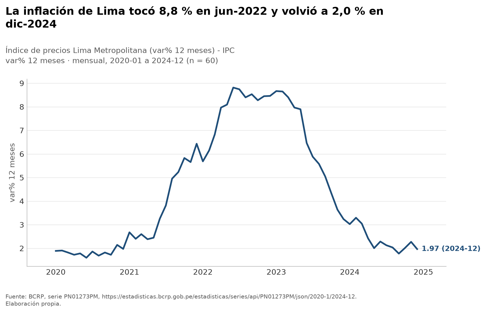
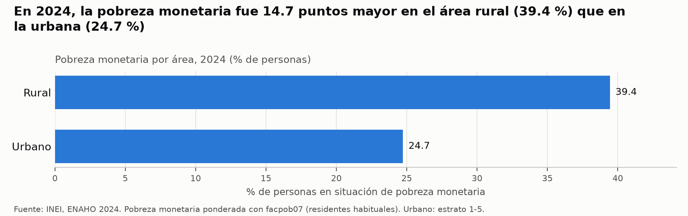
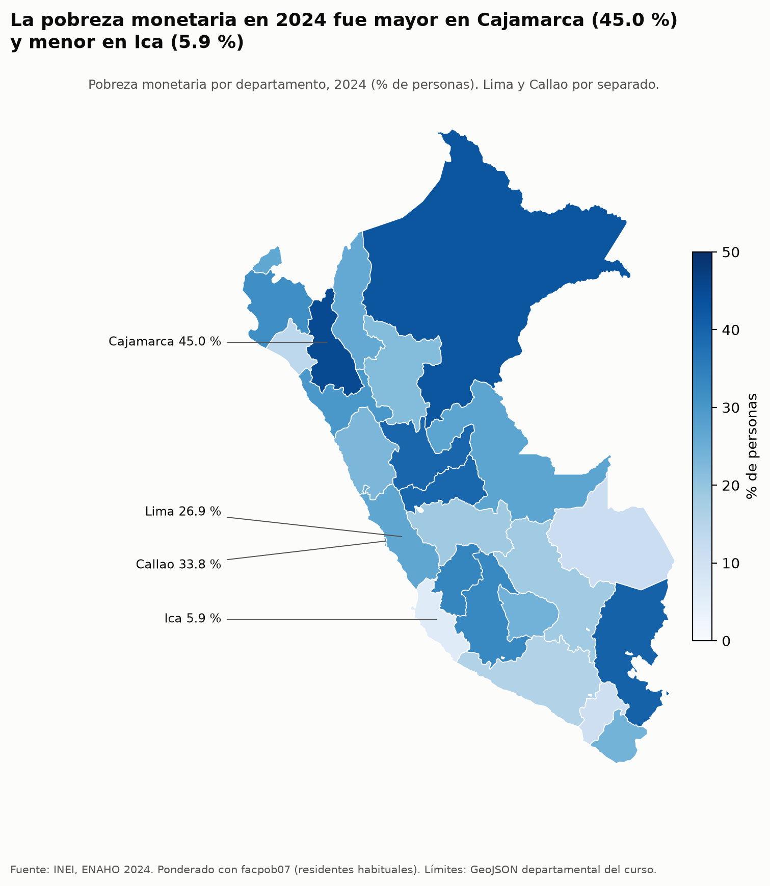

# Informe final – Parte 3: Inflación, tipo de cambio, actividad y pobreza monetaria en el Perú

> Todas las cifras de este informe salen de una herramienta MCP (`resumen`, `graficar_serie`) o de un
> archivo de `salidas/`. Al lado de cada cifra va su fuente: el código de la serie del BCRP o el archivo.
> Las cifras derivadas (valores de diciembre, meses con PBI negativo, brecha) se calculan en
> `scripts/contraste_informe.py` y quedan en `salidas/contraste_informe.txt`.

## 1. Pregunta, objetivo y delimitación

**Pregunta.** ¿Cómo evolucionaron la inflación, el tipo de cambio y la actividad económica del Perú entre
2020 y 2024, y qué diferencias por área y departamento presentaba la pobreza monetaria en 2024?

**Objetivo.** Describir con datos oficiales la trayectoria macroeconómica 2020-2024 y la distribución de la
pobreza monetaria en 2024 por área de residencia y departamento.

**Delimitación.**
- Macro: series mensuales del BCRP de enero de 2020 a diciembre de 2024 (60 meses por serie).
- Pobreza: ENAHO 2024 del INEI (corte transversal de un año), por área (urbano/rural) y por
  25 departamentos (Lima y Callao por separado).
- El análisis es descriptivo y no busca causas.

## 2. Fuentes y metodología

### 2.1 Series del BCRP (servidor MCP `bcrp`)

Las series se identificaron con `buscar_series` y se describieron con `resumen` para 2020-01 a 2024-12.
Los gráficos y los CSV se generaron con `graficar_serie`.

| Variable | Código | Nombre oficial | Unidad | URL consultada |
|---|---|---|---|---|
| Inflación | `PN01273PM` | Índice de precios Lima Metropolitana (var% 12 meses) - IPC | var. % 12 meses | https://estadisticas.bcrp.gob.pe/estadisticas/series/api/PN01273PM/json/2020-1/2024-12 |
| Tipo de cambio | `PN01206PM` | Tipo de cambio - promedio del periodo (S/ por US$) - Interbancario - Venta | S/ por US$ | https://estadisticas.bcrp.gob.pe/estadisticas/series/api/PN01206PM/json/2020-1/2024-12 |
| Actividad | `PN01728AM` | Producto bruto interno y demanda interna (variación porcentual interanual) - PBI | var. % interanual | https://estadisticas.bcrp.gob.pe/estadisticas/series/api/PN01728AM/json/2020-1/2024-12 |

Para el tipo de cambio se eligió el **promedio del periodo** (`PN01206PM`) en vez del fin de periodo
(`PN01215PM`) porque describe mejor el nivel de todo el mes.

### 2.2 ENAHO 2024 (Skills)

- Base: módulos 34 (sumaria) y 02 (miembros del hogar) de la ENAHO 2024 del INEI, ya limpiados y validados
  por la Skill `limpiando-enaho` (`salidas/validacion.txt`: 12 de 12 verificaciones aprobadas). No hizo
  falta volver a ejecutarla porque `salidas/personas_2024.parquet` y `salidas/hogares_2024.parquet` ya
  existían.
- Gráficos: Skill `graficando-enaho`, con `--por area` y `--por departamento`.
- Mapa: Skill `mapeando-enaho`. Une `ubigeo[:2]` con el código del GeoJSON y no usa los nombres.
- **Ponderación:** área, departamento y mapa usan la sumaria de hogares con `factor07 × mieperho`, igual que
  el INEI. Los IC 95 % se calculan por linealización de Taylor (UPM = `conglome`; estratos = departamento ×
  estrato).

## 3. Hallazgos

**H1. La inflación de Lima subió hasta 8,81 % y regresó a 1,97 %.**
La variación a 12 meses del IPC de Lima pasó de 1,89 % en enero de 2020 a un máximo de **8,81 % en junio de
2022**. Cerró 2024 en **1,97 %** (`PN01273PM`, `resumen` 2020-01 a 2024-12). Los valores de diciembre fueron:
2020: 1,97; 2021: 6,43; 2022: 8,46; 2023: 3,24; 2024: 1,97 (`salidas/contraste_informe.txt`). En 34 de los
60 meses la inflación estuvo por encima de 3 %. El promedio del periodo fue 4,47 %.

**H2. El sol se depreció hasta 2021 y luego recuperó parte del valor.**
El tipo de cambio interbancario promedio pasó de **S/ 3,329** por dólar en enero de 2020 a un máximo de
**S/ 4,109 en setiembre de 2021**. En diciembre de 2024 estaba en **S/ 3,737** (`PN01206PM`, `resumen`). Eso
equivale a un alza de 12,25 % entre enero de 2020 y diciembre de 2024, con un promedio de S/ 3,744 en el
periodo.

**H3. La actividad tuvo un desplome, un rebote, una contracción en 2023 y una recuperación en 2024.**
El PBI cayó **39,28 % interanual en abril de 2020** y creció **59,89 % en abril de 2021**; ese salto es un
efecto rebote, porque se compara con la base deprimida de 2020 (`PN01728AM`, `resumen`). En 2023 la
variación interanual fue negativa en **8 de 12 meses**, con un promedio mensual de −0,34 %. En 2024 el
promedio mensual fue **3,48 %** y diciembre cerró en 5,07 % (`PN01728AM`, `resumen` 2023 y 2024;
`salidas/contraste_informe.txt`).

**H4. En 2024 la pobreza rural superó a la urbana por 14,5 puntos.**
La pobreza monetaria fue **39,30 %** en el área rural (IC 95 %: 37,80-40,81) y **24,81 %** en el área urbana
(IC 95 %: 23,62-25,99). Los intervalos no se superponen. El promedio nacional fue **27,58 %** (IC 95 %:
26,59-28,57) (`salidas/grafico_por_area_2024.csv`).

**H5. La pobreza departamental va de 45,0 % en Cajamarca a 6,0 % en Ica.**
Cajamarca (**45,01 %**), Loreto (42,97 %) y Puno (39,94 %) encabezan la lista; Moquegua (10,97 %) e Ica
(**6,01 %**) la cierran (`salidas/grafico_por_departamento_2024.csv`). De los 25 departamentos, 9 tienen el IC
95 % por encima del promedio nacional, 9 por debajo y 7 lo incluyen (subtítulo de
`figuras/pobreza_departamento_2024.png`). Callao (33,86 %) aparece por encima de Lima (27,07 %).

## 4. Visualizaciones

- BCRP, inflación: 
  Otras series: [tipo de cambio](../figuras/bcrp_PN01206PM.png) · [PBI](../figuras/bcrp_PN01728AM.png)
- ENAHO, área: 
  Por departamento (barras con IC): [pobreza_departamento_2024.png](../figuras/pobreza_departamento_2024.png)
- Mapa: 

## 5. Interpretación

Entre 2020 y 2024 la economía peruana pasó por un choque muy fuerte y por un episodio inflacionario. La
inflación de Lima subió durante 2021 y 2022, junto con la depreciación del sol hasta setiembre de 2021, y
bajó en 2023-2024. En diciembre de 2024 volvió al mismo nivel de diciembre de 2020 (1,97 %). La actividad no
se recuperó de forma continua: después del rebote de 2021 tuvo meses de contracción en 2023 y volvió a crecer
en 2024.

En 2024 la pobreza monetaria tenía un fuerte componente territorial. La brecha rural-urbana es
estadísticamente clara, y los departamentos más pobres (Cajamarca, Loreto, Puno, Pasco, Huánuco) son
andinos o amazónicos. Los menos pobres (Ica, Moquegua, Madre de Dios, Lambayeque) están sobre todo en la
costa, con la excepción de Madre de Dios.

Estos dos bloques se presentan juntos como contexto: un periodo de inflación alta y de crecimiento irregular
precede a la foto de pobreza de 2024. Este informe **no** mide cuánto de la pobreza de 2024 se debe a la
inflación o al ciclo económico. Son asociaciones temporales, no relaciones causales.

## 6. Limitaciones

- **Niveles de agregación y periodos distintos.** Las series del BCRP son nacionales (PBI) o de Lima
  (inflación), mensuales y cubren 2020-2024. La ENAHO es una encuesta de hogares de un solo año (2024), con
  desagregación por área y departamento. No se pueden cruzar uno a uno.
- **La inflación es solo de Lima Metropolitana.** `PN01273PM` mide los precios de Lima; no representa los
  precios que enfrentaron los hogares rurales ni los de otros departamentos.
- **Asociaciones, no causas.** Ninguna cifra del informe permite afirmar que la inflación, el tipo de cambio
  o el PBI causaron el nivel de pobreza observado.
- **Lima en la ENAHO no es comparable con las categorías del INEI.** El departamento de Lima (código 15),
  27,07 % en este informe, junta Lima Metropolitana (sin Callao) con Lima provincias. El INEI publica
  «Lima Metropolitana» (que incluye Callao) y «Lima región» por separado, así que la cifra del código 15
  no es directamente comparable con ninguna de las dos.
- **Errores de muestreo.** Las cifras departamentales tienen IC 95 % amplios; el más ancho es el de Tacna, ±5,6 puntos (18,38-29,60)
  (`salidas/grafico_por_departamento_2024.csv`). Diferencias pequeñas entre departamentos no son
  significativas. En un estrato hay una sola UPM; el script lo centra en la media general.
- **Dos ponderaciones válidas.** Con la base de personas y `facpob07` la pobreza es 24,74 % (urbano) y
  39,44 % (rural). Con la sumaria es 24,81 % y 39,30 %. La diferencia viene de 1.846 hogares (5,5 %) en los
  que `mieperho` no coincide con los residentes habituales (`salidas/validacion.txt`). Este informe usa la
  sumaria, que es el método del INEI.
- **Caso de error probado.** Se pidió `serie("PN99999XM", "2020-01", "2024-12")`, un código que no existe.
  El servidor no devolvió datos inventados ni una tabla vacía; respondió con este error:
  > `No existe el código de serie 'PN99999XM'. Búsquenlo con buscar_series.`

  El sistema rechaza los códigos inválidos de forma explícita y orienta al usuario hacia `buscar_series`.

### Contraste de cifras con sus fuentes (paso 7)

Cada cifra principal se volvió a calcular desde su archivo con `scripts/contraste_informe.py`:

| Cifra | En el informe | Contraste | Diferencia |
|---|---|---|---|
| Inflación jun-2022 / dic-2024 (`PN01273PM`) | 8,81 / 1,97 | `resumen` = 8,8126 / 1,9663; CSV igual | ninguna |
| Tipo de cambio ene-2020 / set-2021 / dic-2024 (`PN01206PM`) | 3,329 / 4,109 / 3,737 | `resumen` y CSV coinciden | ninguna |
| PBI abr-2020 / abr-2021 (`PN01728AM`) | −39,28 / 59,89 | `resumen` y CSV coinciden | ninguna |
| Pobreza nacional / urbana / rural (sumaria) | 27,58 / 24,81 / 39,30 | `validacion.txt`: referencia 27,6 / 24,8 / 39,3 | −0,02 / +0,01 / 0,00 pp |
| Cajamarca / Ica / Lima (dpto.) | 45,01 / 6,01 / 27,07 | referencia Sesión 16: 45,0 / 6,0 / 27,1 | +0,01 / +0,01 / −0,03 pp |
| 25 departamentos vs referencia | — | `comparacion_mapa.csv` | máxima 0,05 pp (Amazonas); 25 de 25 a ≤0,1 pp |
| Gráfico de departamentos vs mapa | — | mismas cifras | máxima 0,01 pp (redondeo) |

Diferencias encontradas:
1. Los títulos de los gráficos del BCRP redondean a un decimal: «2,0 %» corresponde a 1,97 % y «S/ 3,74» a
   3,737.
2. Las cifras de ENAHO difieren de las referencias en a lo sumo 0,05 pp. Esa diferencia es de redondeo,
   porque las referencias tienen un decimal.
3. La diferencia entre la ponderación por personas y la de la sumaria (hasta 0,14 pp en el área rural) se
   explica arriba.

## 7. Reproducibilidad

**Series del BCRP** (servidor MCP `mcp/server.py`):
```
buscar_series("ipc 12 meses", frecuencia="Mensual")
buscar_series("tipo de cambio interbancario venta", frecuencia="Mensual")
buscar_series("pbi var", frecuencia="Mensual")
resumen("PN01273PM", "2020-01", "2024-12")
resumen("PN01206PM", "2020-01", "2024-12")
resumen("PN01728AM", "2020-01", "2024-12")
resumen("PN01728AM", "2023-01", "2023-12");  resumen("PN01728AM", "2024-01", "2024-12")
graficar_serie("PN01273PM", "2020-01", "2024-12", "<título>")   -> figuras/bcrp_PN01273PM.png, salidas/bcrp_PN01273PM.csv
graficar_serie("PN01206PM", "2020-01", "2024-12", "<título>")   -> figuras/bcrp_PN01206PM.png, salidas/bcrp_PN01206PM.csv
graficar_serie("PN01728AM", "2020-01", "2024-12", "<título>")   -> figuras/bcrp_PN01728AM.png, salidas/bcrp_PN01728AM.csv
serie("PN99999XM", "2020-01", "2024-12")                        -> error (caso de prueba)
```

**ENAHO** (Skills en `.claude/skills/`; comandos que ejecutaron, desde la raíz del proyecto):
```
uv run python .claude/skills/limpiando-enaho/scripts/limpiar.py   # solo si falta salidas/personas_2024.parquet
uv run python .claude/skills/graficando-enaho/scripts/graficar.py --por area --indicador pobreza
uv run python .claude/skills/graficando-enaho/scripts/graficar.py --por departamento --indicador pobreza
uv run python .claude/skills/mapeando-enaho/scripts/mapear.py
```

**Contraste:**
```
uv run python scripts/contraste_informe.py    -> salidas/contraste_informe.txt
```

**Archivos de datos de entrada:** `datos/966-Modulo02.zip`, `datos/966-Modulo34.zip`,
`datos/peru_departamental_simple.geojson`, `datos/pobreza_departamento_2024.csv` (referencia de la
Sesión 16).

**Salidas usadas:** `salidas/bcrp_PN01273PM.csv`, `salidas/bcrp_PN01206PM.csv`, `salidas/bcrp_PN01728AM.csv`,
`salidas/grafico_por_area_2024.csv`, `salidas/grafico_por_departamento_2024.csv`,
`salidas/comparacion_mapa.csv`, `salidas/validacion.txt`, `salidas/contraste_informe.txt`.
